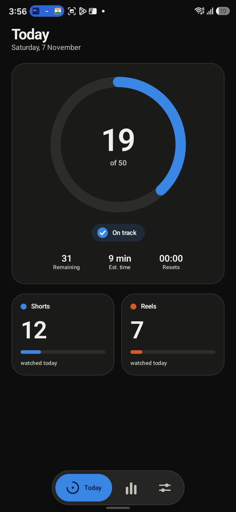
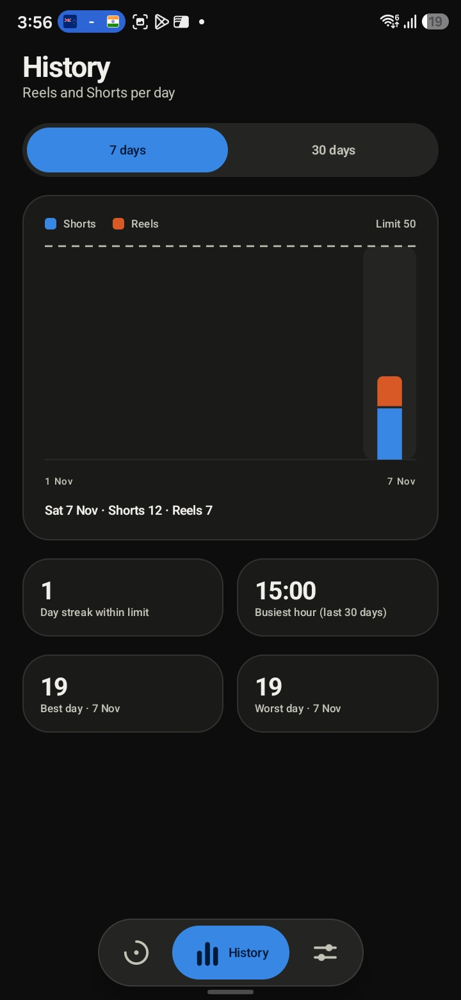
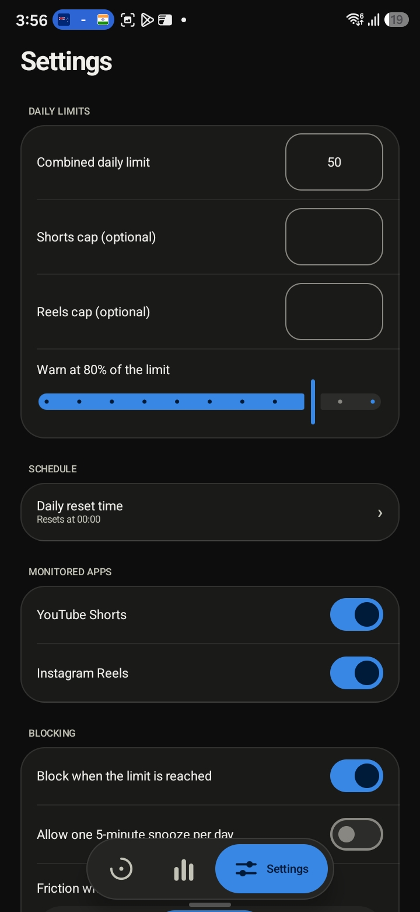

# ReelGuard

[](https://github.com/bilal8492/reelguard/actions/workflows/ci.yml)
[](LICENSE)

An Android app that counts the Instagram Reels and YouTube Shorts you watch each day, lets you set a daily limit, and
shows a "limit reached" screen when you hit it. Regular videos, feeds, stories and messages are never blocked.
What you watch and your counts stay on your device: no account, no ads. Anonymous usage statistics (app opens and your
country) are on by default and can be switched off in Settings.

**Website:** https://bilalansari.in/reelguard/ · **Download:** [latest release](https://github.com/bilal8492/reelguard/releases/latest)

## Screenshots

<p>
  
  
  
</p>

## Install (APK)

ReelGuard is not on Google Play. Download `ReelGuard-vX.Y.Z.apk` from the
[Releases page](https://github.com/bilal8492/reelguard/releases/latest), open it, and allow installing from your
browser/file manager. Optionally verify the checksum against the `.sha256` file. On Android 13+, if the accessibility
switch is greyed out: App info > ReelGuard > menu > *Allow restricted settings*, then enable it under Accessibility.

### "App blocked to protect your device"?

In some countries (India is one) Google Play Protect blocks apps that use an **accessibility service** when they are
installed from a browser or a file manager. It shows *"App blocked to protect your device"* with only an **OK** button.
Google does this as an anti-fraud measure, based on the permissions an app asks for, not because a scan found anything
wrong ([Google's explanation](https://developers.google.com/android/play-protect/warning-dev-guidance)). ReelGuard needs an accessibility
service to see whether Reels/Shorts is on screen, so it is caught by the rule. You can check your download against the
`.sha256` file from the same release.

Ways to install anyway:

1. **From a computer over USB.** Install Android's [platform-tools](https://developer.android.com/tools/releases/platform-tools), turn on *USB debugging* on the
   phone (Settings > Developer options), connect it and run `adb install ReelGuard-vX.Y.Z.apk`. No security setting has
   to change, and it worked in our tests with Play Protect left on.
2. **Pause Play Protect while you install.** In the Play Store tap your profile picture > **Play Protect** > the gear icon
   and turn off **Scan apps with Play Protect**, install ReelGuard, then turn it back on. Some people get past the block
   this way, but we have not confirmed it on every phone, and your phone is less protected until you switch it back on.

> Detection IDs are best-effort and not yet verified across many devices; see `docs/TEST_RESULTS.md` and
> `docs/SELECTORS.md`. Please report problems.

## Privacy

See [PRIVACY.md](PRIVACY.md). What you watch, your counts and your settings never leave your device. Released APKs
share anonymous usage statistics (app opens and country; on by default, off in Settings > Privacy) and check Firebase
Remote Config for detection updates.

## Build from source

Requires JDK 17 and Android SDK 35.

```bash
./gradlew assembleDebug      # APK in app/build/outputs/apk/debug
./gradlew test               # unit tests
```

Optional: put your own `app/google-services.json` in place to enable Firebase (Remote Config for selector updates and
anonymous usage statistics). It is git-ignored; without it the app builds and runs offline and makes no network
requests. Release signing reads `keystore.properties` (also git-ignored).

## Releasing (maintainers)

Add repository secrets `KEYSTORE_BASE64`, `KEYSTORE_PASSWORD`, `KEY_ALIAS`, `KEY_PASSWORD` (and, to ship Firebase in the
release, `GOOGLE_SERVICES_JSON_BASE64`: the base64 of your `google-services.json`), then push a tag:

```bash
git tag v0.1.0 && git push origin v0.1.0
```

The *Release APK* workflow tests, signs, and publishes the APK plus checksum to GitHub Releases.

## License

[MIT](LICENSE). See also [SECURITY.md](SECURITY.md) and [CONTRIBUTING.md](CONTRIBUTING.md).
